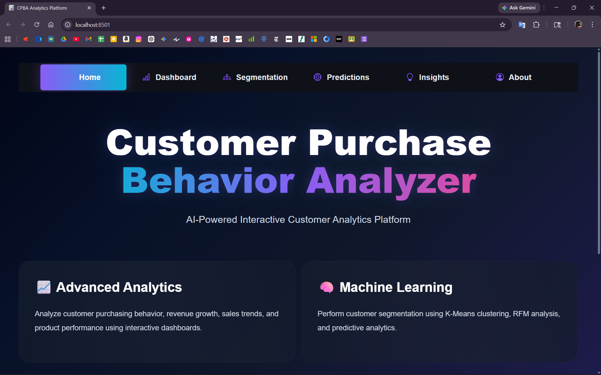
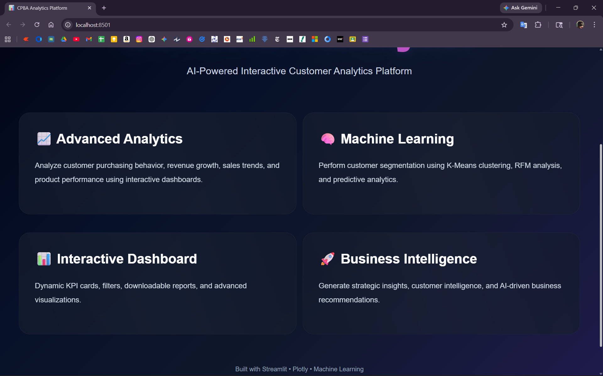
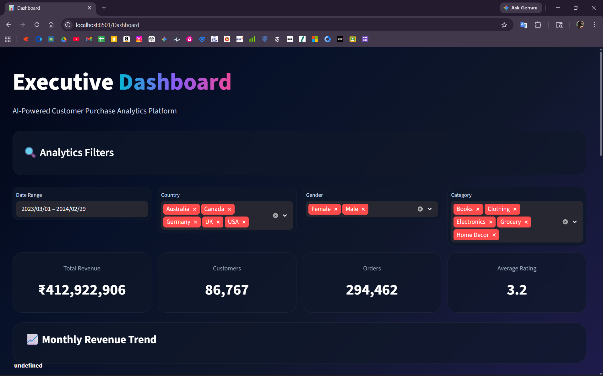
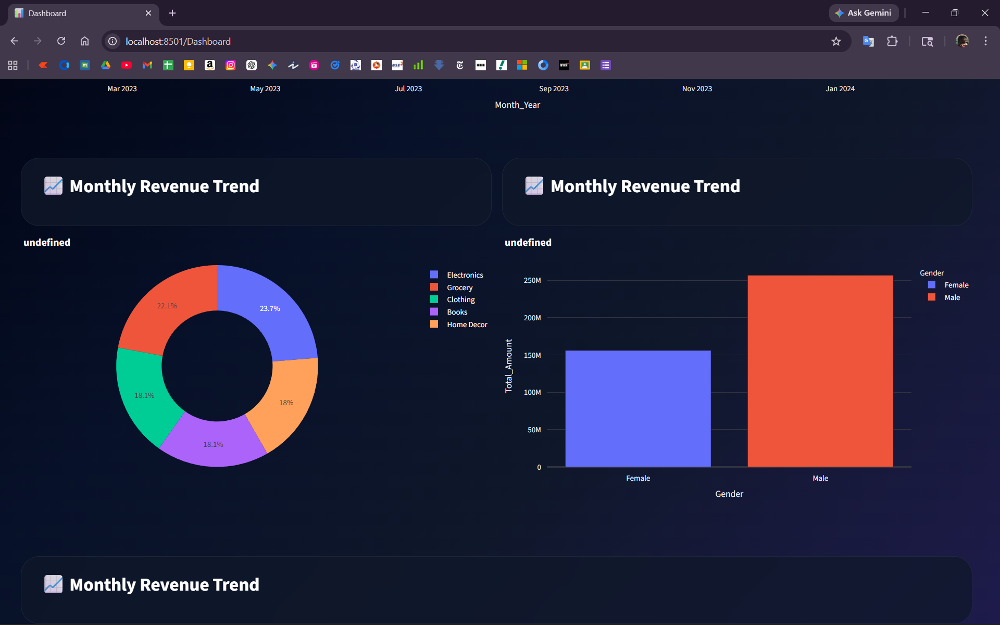
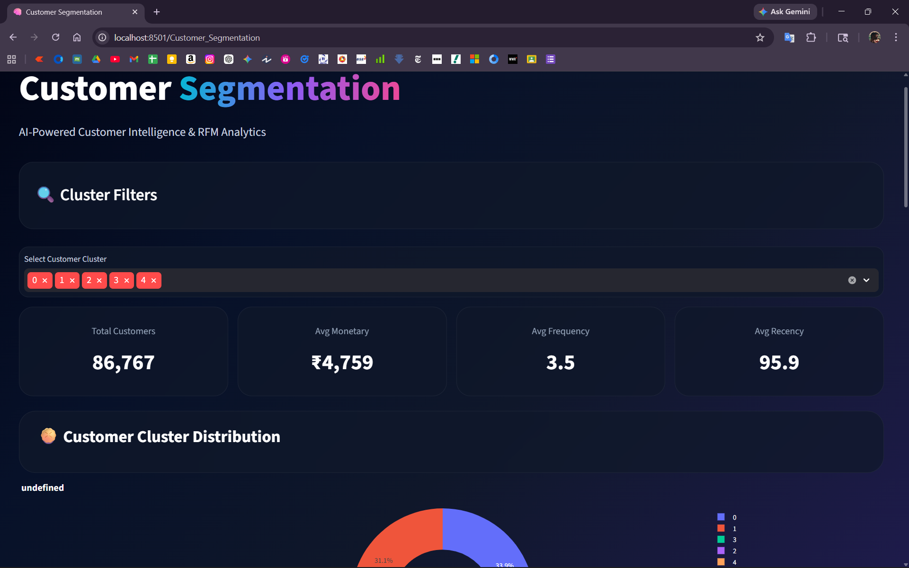
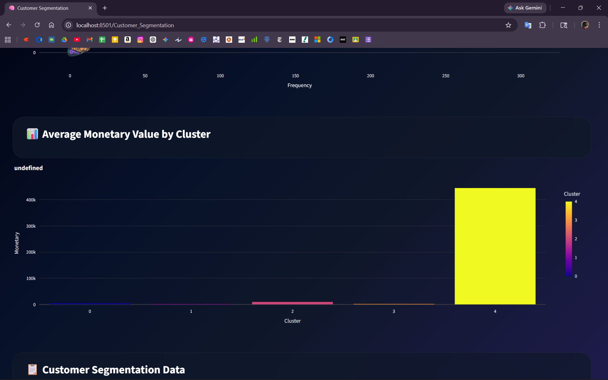
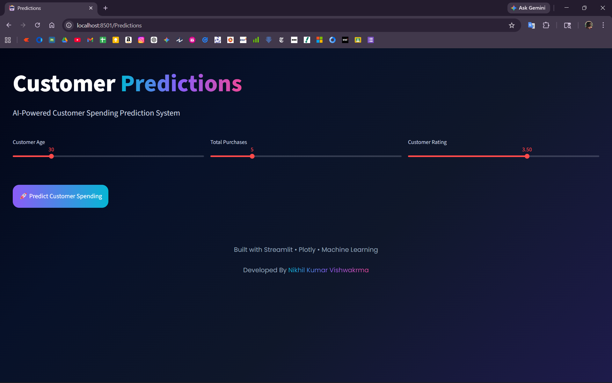
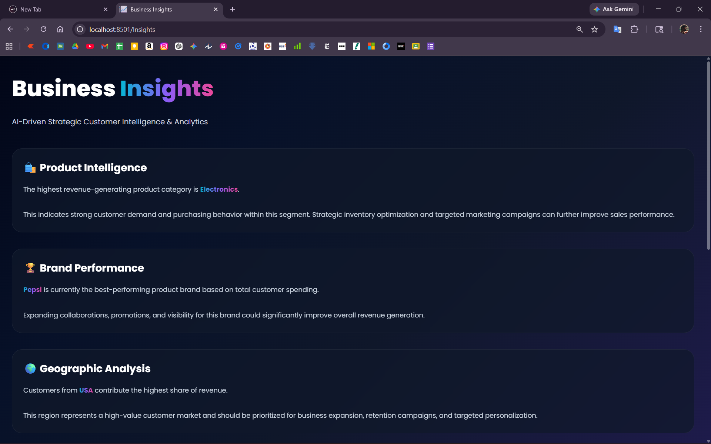
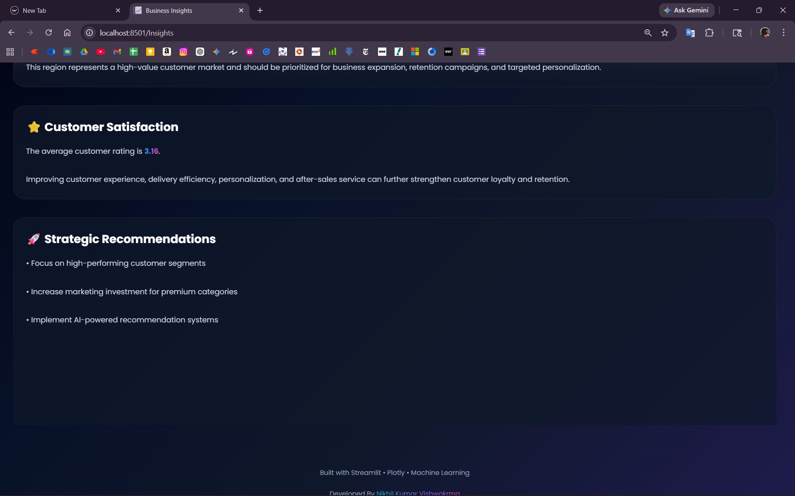

# 🚀 Customer Purchase Behavior Analyzer (CPBA)

<div align="center">


### AI-Powered Customer Analytics & Business Intelligence Platform

</div>

---

# 📑 Table of Contents

- [📌 Project Overview](#-project-overview)
- [🎯 Project Objectives](#-project-objectives)
- [⚡ Core Features](#-core-features)
- [🧠 Machine Learning Features](#-machine-learning-features)
- [📊 Dashboard Modules](#-dashboard-modules)
- [🛠️ Technology Stack](#️-technology-stack)
- [📂 Project Structure](#-project-structure)
- [📈 Dataset Information](#-dataset-information)
- [🚀 Installation & Setup](#-installation--setup)
- [▶️ Run the Project](#️-run-the-project)
- [📸 Project Screenshots](#-project-screenshots)
- [🌟 My Journey Through This Project](#-my-journey-through-this-project)
- [📌 Challenges Faced](#-challenges-faced)
- [📊 Future Improvements](#-future-improvements)
- [👨‍💻 Developer Information](#-developer-information)
- [📄 License](#-license)

---

# 📌 Project Overview

Customer Purchase Behavior Analyzer (CPBA) is an advanced AI-powered analytics platform developed to analyze customer purchasing behavior, business trends, revenue analytics, customer segmentation, and predictive intelligence.

The platform transforms raw customer transactional data into meaningful business intelligence using:

- Interactive dashboards
- Machine learning models
- Customer segmentation
- Predictive analytics
- Executive business insights

CPBA was designed as a real-world enterprise analytics platform combining:

- Data Analytics
- Business Intelligence
- Machine Learning
- Interactive Dashboard Engineering
- Modern UI/UX Design

---

# 🎯 Project Objectives

The primary objective of CPBA is to help businesses:

- Understand customer purchasing behavior
- Improve customer targeting
- Increase revenue growth
- Predict future customer spending
- Optimize inventory management
- Improve customer retention
- Generate business intelligence insights
- Enable data-driven decision making

---

# ⚡ Core Features

## 📊 Executive Dashboard

- Revenue analytics
- Monthly sales trends
- Product category analysis
- KPI monitoring
- Brand performance tracking
- Interactive filters

---

## 🧠 Customer Segmentation

- RFM Analysis
- Customer clustering
- Segmentation intelligence
- Frequency vs Monetary analysis
- Customer behavior insights

---

## 🤖 Spending Prediction System

- AI-powered customer spending prediction
- Machine learning model integration
- Real-time prediction engine
- Interactive user inputs

---

## 📈 Business Insights Engine

- AI-generated strategic insights
- Product intelligence
- Geographic analytics
- Customer satisfaction analysis
- Executive recommendations

---

## 🎨 Modern UI/UX

- Glassmorphism design
- Dark futuristic theme
- Interactive animations
- Responsive dashboard layout
- Enterprise-grade aesthetics

---

# 🧠 Machine Learning Features

The project integrates machine learning models for:

## 🔹 Customer Spending Prediction

Predicts customer spending amount using:

- Customer age
- Purchase frequency
- Customer ratings

---

## 🔹 Customer Segmentation

Implements clustering techniques for:

- RFM Analysis
- Customer intelligence
- Segment identification

---

# 📊 Dashboard Modules

| Module | Description |
|---|---|
| 🏠 Home | Project landing page |
| 📊 Dashboard | Revenue & KPI analytics |
| 🧠 Segmentation | Customer clustering analytics |
| 🤖 Predictions | Spending prediction system |
| 📈 Insights | AI-driven business insights |
| 🚀 About | Complete project journey |

---

# 🛠️ Technology Stack

## 🔹 Programming Languages

- Python

---

## 🔹 Libraries & Frameworks

### Frontend / Dashboard

- Streamlit
- HTML
- CSS

### Data Analytics

- Pandas
- NumPy

### Visualization

- Plotly Express

### Machine Learning

- Scikit-Learn
- Joblib

---

# 📂 Project Structure

```bash
CPBA/
│
├── Dataset/
│   ├── cleaned_customer_purchase_data.csv
│   └── rfm_customer_segments.csv
│
├── Streamlit_App/
│   │
│   ├── Home.py
│   │
│   ├── models/
│   │
│   └── pages/
│       ├── 1_Dashboard.py
│       ├── 2_Customer_Segmentation.py
│       ├── 3_Predictions.py
│       ├── 4_Insights.py
│       └── 5_About.py
│
├── notebooks/
│
├── README.md
│
└── requirements.txt
```

---

# 📈 Dataset Information

The dataset contains customer transactional data including:

- Customer ID
- Product Categories
- Product Brands
- Country
- Gender
- Ratings
- Purchase Amount
- Purchase Dates
- Revenue Metrics

The data was cleaned and processed before analytics and machine learning implementation.

---

# 🚀 Installation & Setup

## 1️⃣ Clone Repository

```bash
git clone https://github.com/nikhilvishwakrma2002/customer-purchase-behavior-analysis-python-matplotlib-streamlit-ml.git
```

---

## 2️⃣ Navigate to Project

```bash
cd CPBA
```

---

## 3️⃣ Install Dependencies

```bash
pip install -r requirements.txt
```

---

# ▶️ Run the Project

```bash
streamlit run Home.py
```

---

# 📸 Project Screenshots

## 🏠 Home Page

- Modern enterprise landing page
- Interactive navigation
- Glassmorphism UI
<p>
    
</p>
<p>
    
</p>
---

## 📊 Dashboard

- Revenue trends
- KPI cards
- Interactive charts
<p>
    
</p>
<p>
    
</p>
---

## 🧠 Customer Segmentation

- RFM clustering
- Customer intelligence analytics
- Scatter visualizations
<p>
    
</p>
<p>
    
</p>
---

## 🤖 Prediction System

- AI-powered spending prediction
- Real-time prediction engine
<p>
    
</p>
---

## 📈 Business Insights

- Executive strategic insights
- AI-driven recommendations
<p>
    
</p>
<p>
    
</p>
---

# 🌟 My Journey Through This Project

This project started with the idea of building a real-world AI-powered analytics platform capable of transforming customer transactional data into meaningful business intelligence.

During development, multiple challenges were faced including:

- Dashboard optimization
- Streamlit UI engineering
- Machine learning integration
- Interactive visualizations
- Responsive frontend design
- Business intelligence modeling

The project gradually evolved from a basic analytics dashboard into a complete enterprise-level customer analytics ecosystem.

This journey significantly improved skills in:

- Data Analytics
- Machine Learning
- Dashboard Development
- Business Intelligence
- UI/UX Design
- Problem Solving
- Interactive Visualization

---

# 📌 Challenges Faced

Some major challenges during development:

- Streamlit UI customization
- Glassmorphism implementation
- Managing interactive visualizations
- Handling HTML rendering issues
- Prediction model integration
- Dashboard responsiveness
- Dynamic filtering systems

---

# 📊 Future Improvements

Planned future enhancements:

- Real-time database integration
- Authentication system
- Advanced forecasting models
- NLP-based recommendation system
- Deep learning integration
- Cloud deployment
- API integration
- User management system

---

# 👨‍💻 Developer Information

## 👤 Nikhil Kumar Vishwakrma

### 🎓 BCA (Data Science & AI)

Passionate about:

- Artificial Intelligence
- Data Analytics
- Machine Learning
- Dashboard Engineering
- Business Intelligence
- UI/UX Design

## Linkedin : www.linkedin.com/in/nikhilvishwakrma2002

## Email : nikhilvishwakrma2002@gmail.com
---

# 📄 License

This project is developed for educational and portfolio purposes.

---

<div align="center">

### ⭐ If you like this project, consider giving it a star!

</div>
